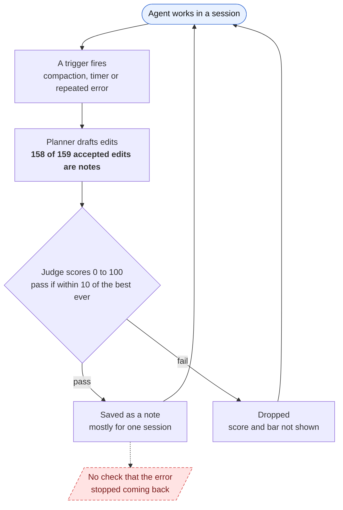
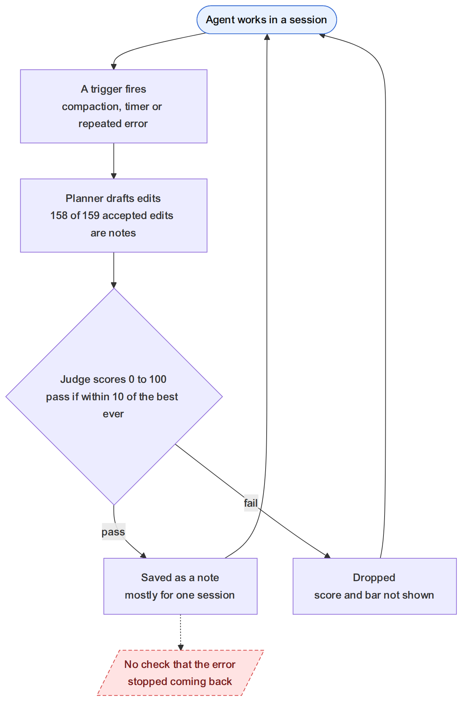
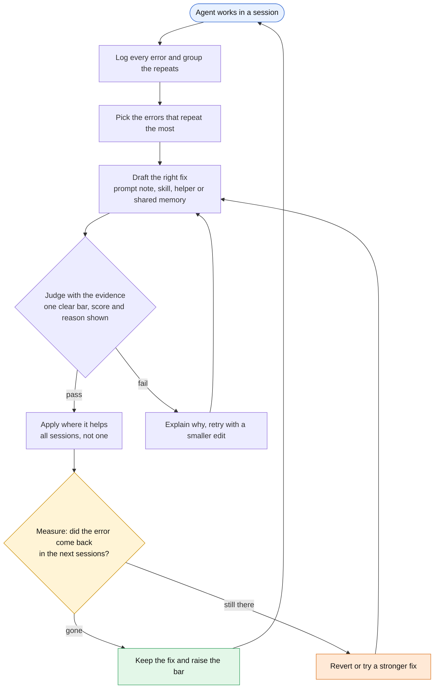
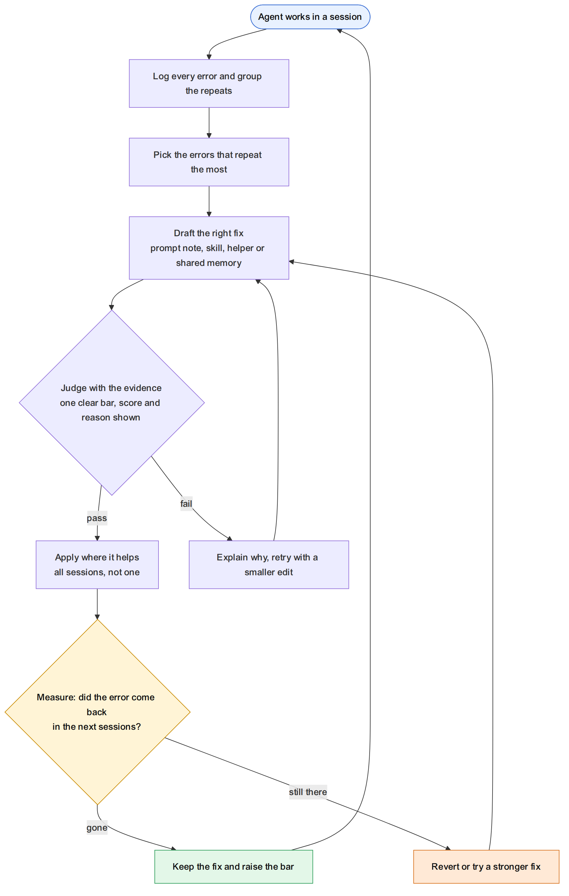
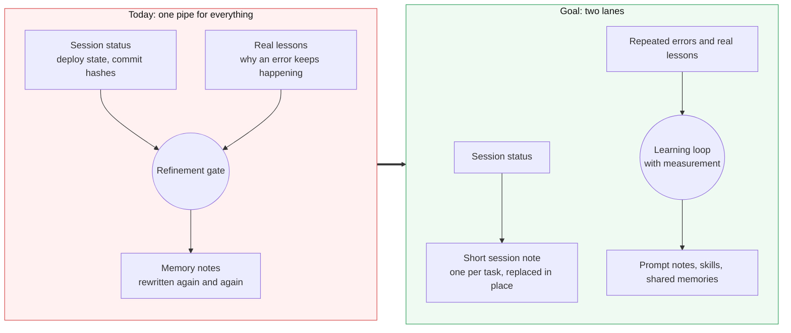

# Refinement: how it works today, and what we want

Audience: leadership. Evidence: the refinement history and failure ledger on this machine, read on 2026-11-01.
Everything marked "goal" is a proposal, not a decision.

## In one sentence

Today the system writes a lot of notes but does not check whether they help. The goal is a loop that picks the errors
that repeat, fixes them, and then checks that they stopped.

## 1. Today: a loop with no measurement

What the numbers say (204 proposals from Aug 19 to Oct 29):

- 147 accepted, 51 rejected.
- 158 of 159 accepted edits are memory notes. One is a prompt note. None are skills or helpers.
- Only 6 of the 147 accepted proposals targeted a recorded error.
- The error log holds 659 kinds of error and 4,304 occurrences. None is marked as fixed.
- One status note was rewritten 38 times.
- Of the 4 fixes the gate tracked, 3 never came back and 1 came back 13 days later. The counts are small (2 to 8).

## 2. Goal: a closed loop that measures

The two new pieces are the yellow box (measure) and the way a failed measurement feeds back into the next draft.

## 3. Keep status notes and lessons apart

Most of today's traffic is session status. It crowds out the lessons that would reduce errors, and it competes for the same
quality bar.

## 4. What changes, in plain terms

| Topic | Today | Goal |
|---|---|---|
| What gets fixed | Whatever the last session produced | The errors that repeat the most |
| Kinds of fix | Almost only memory notes | Prompt notes, skills and shared memories as needed |
| Where a fix applies | Mostly one session | All sessions when the lesson is general |
| The quality bar | 0 to 95 depending on the store | One rule per kind of edit |
| What the judge sees | The last ~40,000 characters of the chat | The turns the proposal cites |
| A rejection tells you | The judge's text only | Score, bar, reason and which edit was weak |
| After a fix | Nothing is checked | The error is tracked for the next sessions; a fix that fails is reverted |

## 5. How we will know it works

| Measure | Today | Goal |
|---|---|---|
| Accepted proposals that target a recorded error | 4% (6 of 147) | Most of them |
| Errors with a tracked fix | 0 of 659 | Every accepted fix |
| Fixed errors that come back within 30 days | not measured | Falling month over month |
| Share of Python results that are errors | 3% to 5% over the last 3 weeks | Falling |
| Time from a rejection to a resubmitted fix | not measured | Under one session |

## Caveats

- The history is partial: logs rotate, and only about three weeks of session files remain.
- The error-rate numbers have no control group, so they cannot show cause.
- The counts of fixes that "never came back" rest on 2 to 8 occurrences each.
- The target flow is a design proposal. Nothing in it is built yet.
